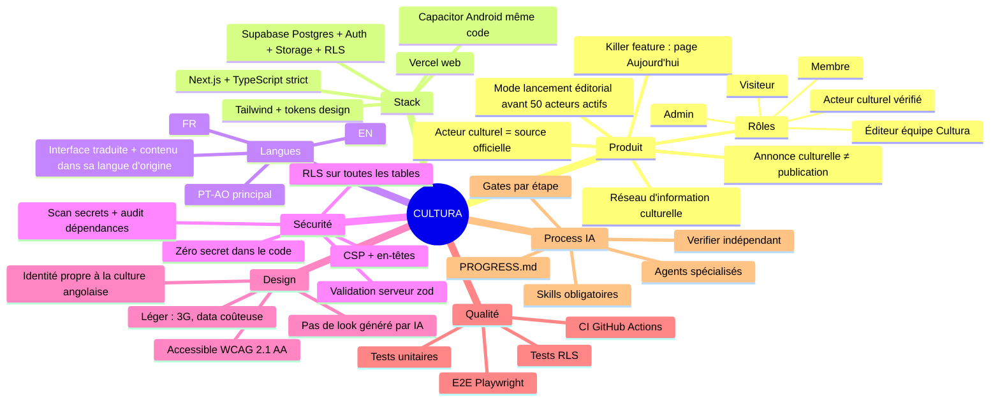
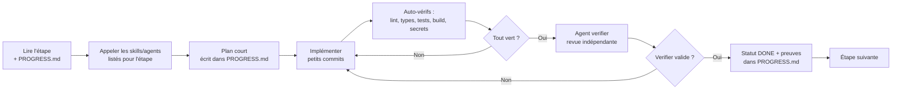

# CULTURA — Guide d'exécution pour l'IA de codage

**Document de pilotage** — à lire en entier avant la première ligne de code.
**Source produit :** `CULTURA_CAHIER_DES_CHARGES_v1.3.md` (en pièce jointe, même dossier).
**Priorité en cas de conflit :** 1) Cahier des charges v1.3 (il intègre tous les amendements du guide) → 2) Ce guide (méthode, sécurité, design) → 3) Initiatives de l'IA (interdites sans validation).

---

## 0. Règles d'or (non négociables)

1. **Une étape à la fois.** Aucune étape N+1 n'est commencée tant que l'étape N n'est pas au statut `DONE` avec preuves écrites dans `PROGRESS.md`.
2. **Jamais seul.** Chaque étape impose l'appel de skills et/ou d'agents listés (section 6). Les ignorer = étape invalide. Si un skill/agent est indisponible, le noter dans `PROGRESS.md` et utiliser un sous-agent avec la checklist équivalente. Jamais de saut silencieux.
3. **Celui qui construit ne valide pas.** Le statut `DONE` est posé par l'agent `verifier` (indépendant), pas par l'agent qui a codé.
4. **Pas de preuve, pas de DONE.** Une preuve = sortie réelle d'une commande (lint, tests, build, scan secrets), pas une affirmation.
5. **Aucun secret dans le code ni dans Git.** Jamais. Voir section 7.
6. **Pas d'initiative hors périmètre.** Le périmètre MVP du cahier (section 5) est fermé. Toute idée hors périmètre va dans `BACKLOG.md`, pas dans le code.
7. **En cas de doute, s'arrêter et demander.** Ne pas deviner une règle métier.
8. **Si une vérification échoue :** corriger, relancer **toutes** les vérifications de l'étape, pas seulement celle qui a échoué. Après 3 échecs consécutifs sur la même cause → stop, écrire un rapport de blocage, demander à l'humain.

---

## 1. Mind graph

### 1.1 Vue d'ensemble du projet



### 1.2 Graphe des phases (ordre strict, aucune parallélisation)

```mermaid
flowchart TD
    P0[P0 Cadrage et décisions<br/>ADR, spike Capacitor, design plan] --> G0{Gate G0}
    G0 --> P1[P1 Fondations<br/>repo, outillage, CI, i18n, tokens]
    P1 --> G1{Gate G1}
    G1 --> P2[P2 Base de données<br/>migrations, RLS, seed]
    P2 --> G2{Gate G2}
    G2 --> P3[P3 Auth et rôles]
    P3 --> G3{Gate G3}
    G3 --> P4[P4 Espace acteur culturel<br/>profil, annonces, événements]
    P4 --> G4{Gate G4}
    G4 --> P5[P5 Admin, éditorial et modération]
    P5 --> G5{Gate G5}
    G5 --> P6[P6 Public<br/>Aujourd'hui, flux, agenda, recherche]
    P6 --> G6{Gate G6}
    G6 --> P7[P7 Interaction<br/>likes, favoris, ville, WhatsApp, vues, score, stats]
    P7 --> G7{Gate G7}
    G7 --> P8[P8 SEO, performance, a11y, i18n complète]
    P8 --> G8{Gate G8}
    G8 --> P9[P9 Android Capacitor]
    P9 --> G9{Gate G9}
    G9 --> P10[P10 Qualité finale et lancement pilote]
    P10 --> G10{Gate G10 : livraison}
```



### 1.3 Boucle obligatoire de chaque étape



---

## 2. Historique des amendements (tous intégrés au cahier v1.3)

| # | Sujet | Cahier | Amendement |
|---|---|---|---|
| A1 | **Langues** | PT principal, FR/EN « phase ultérieure » | **PT-AO, FR et EN dès la V1.** Tout texte d'interface passe par des clés i18n. Aucun texte en dur. |
| A2 | **Mobile** | Flutter en phase ultérieure | **Capacitor** : même code pour le web et l'Android. Flutter abandonné. |
| A3 | **Rôle « membre »** | `role IN ('visiteur','acteur','admin')` | Remplacer par `('membre','acteur','editeur','admin')` (voir A13). Le visiteur n'a pas de compte (non connecté). |
| A4 | **Statistiques** | Seule la table `views` existe, or le module stats demande clics et partages | Ajouter les tables `shares` et `clicks` (ou une table `interactions` typée) avec RLS. |
| A5 | **Spotify** | Prioritaire MVP, mais aucune colonne | Ajouter `spotify_url` aux `annonces` (validation d'URL par liste blanche de domaines). |
| A6 | **Langue du contenu** | Non traitée | Ajouter `langue` (`pt`,`fr`,`en`) aux `annonces`/`events`. L'interface est traduite ; le contenu reste dans sa langue d'origine. Pas de traduction automatique en V1. |
| A7 | **Fuseau horaire** | Non traité | Stocker en UTC, afficher en `Africa/Luanda` (UTC+1, sans heure d'été). |
| A8 | **Monnaie** | Texte libre pour `prix` | Conserver `prix` texte mais ajouter `prix_kz` numérique optionnel + `gratuit` booléen pour filtrer. |
| A9 | **Suppression de compte** | Absente | Obligatoire (exigence Google Play + protection des données). Voir section 8. |
| A10 | **Signalement** | Absent | Bouton « signaler une annonce » → file admin (nécessaire pour la modération). |
| A11 | **Doublons d'événements** | Non traité | Détection simple à la création (même titre + date + lieu) avec avertissement à l'acteur. |
| A12 | **Vues** | 1 ligne par vue | Dédupliquer (1 vue / session / annonce / heure) et agréger quotidiennement pour ne pas saturer les 500 Mo gratuits. |
| A13 | **Rôle Éditeur** | Seul l'admin gère le contenu | Ajouter le rôle `editeur` (équipe Cultura). Éditeur et admin créent/modifient fiches, événements et annonces. L'éditeur ne gère ni rôles, ni vérification, ni suppression de comptes. Voir cahier v1.3 §4.7. |
| A14 | **Fiches gérées par l'équipe** | Inexistantes | `acteurs_culturels.user_id` nullable ; `statut_fiche` (`geree_par_equipe`/`revendiquee`) ; `cree_par` ; `source_url` obligatoire. `annonces` et `events` : `origine` (`acteur`/`equipe`) + `source_url` obligatoire si `equipe`. |
| A15 | **Publication éditoriale directe** | File de modération pour tout | Admin/éditeur publient sans file, mais **chaque action est journalisée** dans `moderation_log` (`cree_editorial`, `modifie_editorial`). Pas de badge « vérifié » sur une fiche non revendiquée. Mention publique « Information publiée par l'équipe Cultura d'après une source publique ». |
| A16 | **Revendication de fiche** | Inexistante | Bouton « Revendiquer cette fiche » → demande avec preuve (email officiel, code publié sur un réseau officiel, ou appel) → l'admin approuve → `user_id` rattaché, contenus conservés. Une fiche = un seul propriétaire ; toutes les demandes sont tracées (anti-usurpation). |
| A17 | **Règle de lancement** | Absente | Mode éditorial actif tant que < 50 acteurs actifs. « Actif » = au moins une annonce ou un événement publié dans les 90 derniers jours (**à confirmer par l'humain**). Seuil configurable, jamais en dur. |
| A18 | **Retrait et droits d'auteur** | Absents | Formulaire « Demander une correction ou un retrait » sur chaque fiche (table `demandes_retrait`, objectif 48 h). Images : uniquement fournies, libres de droits ou autorisées ; jamais copiées sans accord. Saisie **manuelle** : le scraping reste interdit en V1. |
| A19 | **Interactions sur événements** | `likes`, `favorites`, `views` ne pointent que vers `annonces` alors que les événements sont une table distincte | Chaque table d'interaction porte `annonce_id` ou `event_id` (exactement un des deux, contrainte `CHECK`). |
| A20 | **Ville suivie** | `users.ville_suivie` doublonne `villes_suivies` | Colonne supprimée ; seule `villes_suivies` fait foi. |
| A21 | **Champs manquants** | Genre, liens sociaux, champs propres à chaque format absents du schéma | Ajout de `genre`, `liens`, `donnees` (JSONB par format), `langue_preferee`. |

> Tous ces amendements (A1 à A21) sont intégrés au cahier des charges v1.3, qui fait foi. Ce tableau n'est qu'un historique : en cas de doute, se référer au cahier.

---

## 3. Fichiers de pilotage à créer à la racine du dépôt (étape P1.1)

| Fichier | Rôle |
|---|---|
| `CLAUDE.md` (ou `AGENTS.md`) | Copie condensée des règles d'or (section 0) + liens vers ce guide et le cahier |
| `PROGRESS.md` | Journal d'avancement : une entrée par étape, statut, preuves |
| `BACKLOG.md` | Idées hors périmètre |
| `DECISIONS/ADR-xxx.md` | Décisions d'architecture (une par décision) |
| `.env.example` | Noms des variables, **jamais de valeurs réelles** |
| `.claude/agents/*.md` | Définition des agents (section 6.2) |

### 3.1 Modèle d'entrée `PROGRESS.md`

```markdown
## [P4.2] Création d'annonce (acteur)
- Statut : TODO | IN_PROGRESS | VERIFYING | BLOCKED | DONE
- Skills/agents appelés : (liste, avec date)
- Plan : (3 à 6 lignes)
- Preuves :
  - lint : (sortie)
  - typecheck : (sortie)
  - tests : (n passés / n total)
  - build web : OK/KO
  - build mobile : OK/KO (si applicable)
  - scan secrets : 0 fuite
  - i18n : clés PT/FR/EN complètes
  - a11y rapide : (outil + résultat)
- Verdict verifier : VALIDÉ / REFUSÉ + motifs
- Écarts / dette : (ou « aucun »)
```

---

## 4. Définition de « terminé » (DoD générique, applicable à chaque étape)

Une étape n'est `DONE` que si **tous** les points sont vrais :

- [ ] Les critères d'acceptation propres à l'étape (section 9) sont tous satisfaits.
- [ ] `lint` : 0 erreur, 0 warning nouveau.
- [ ] `typecheck` (TypeScript `strict`) : 0 erreur. Pas de `any` ni `@ts-ignore` sans justification écrite.
- [ ] Tests de l'étape écrits **et** verts. Pas de test supprimé ou désactivé pour passer.
- [ ] `build` web OK. `build` mobile OK dès que le spike Capacitor (P0.2) est validé.
- [ ] Scan de secrets : 0 fuite (`gitleaks` ou équivalent).
- [ ] Audit dépendances : 0 vulnérabilité haute ou critique non justifiée.
- [ ] i18n : toute nouvelle chaîne existe en **PT, FR et EN**.
- [ ] États vides, chargement et erreur gérés (jamais d'écran blanc).
- [ ] Accessibilité de base : focus visible, labels, contrastes, navigation clavier.
- [ ] Aucune donnée sensible dans les logs.
- [ ] `PROGRESS.md` mis à jour avec preuves ; commit conventionnel (`feat:`, `fix:`, `chore:`…).
- [ ] Verdict `VALIDÉ` du `verifier`.

---

## 5. Périmètre MVP (rappel)

**Inclus :** Visiteur, Membre, Acteur culturel, Éditeur (back-office éditorial), Admin, page « Aujourd'hui », flux, agenda, géolocalisation ville/commune/quartier, score de popularité, compteur de vues, partage WhatsApp, suivre une ville, YouTube/Spotify en embed, statistiques acteur.
**Exclus en V1 :** commentaires, messagerie, followers, stories, notifications push, scraping, billetterie, IA de recommandation. Ne pas les coder, même « en préparation ». Les emails transactionnels (confirmation, décision de modération) sont autorisés : ce ne sont pas des notifications push. La monétisation (cahier §11) est hors périmètre de ce guide.

---

## 6. Skills et agents

### 6.1 Skills à appeler (selon disponibilité dans l'environnement)

| Moment | Skill / outil | Usage obligatoire |
|---|---|---|
| P0 Architecture | `engineering:architecture`, `engineering:system-design` | ADR du double build Next.js/Capacitor, modèle de données |
| P0 Design | `frontend-design`, `web-design-system` (création de `DESIGN.md`), `design:design-system` | Plan de design, tokens, **revue anti-« look IA »** avant tout code UI |
| P1 Dépôt/Docs | `engineering:documentation` | README, guide de contribution |
| P2 Base de données | Supabase MCP (`apply_migration`, `list_tables`, `get_advisors`, `generate_typescript_types`), `data:write-query` | Migrations versionnées ; **`get_advisors` (sécurité) après chaque migration** |
| Toute phase | `engineering:testing-strategy` | Stratégie de tests de l'étape |
| Toute phase | `engineering:code-review` | Revue avant passage à `VERIFYING` |
| P3 à P7 | `design:ux-copy` | Libellés, erreurs, états vides en PT/FR/EN |
| P6 à P8 | `landing-page`, `web-review` | Cohérence design, revue des pages publiques |
| P8 SEO | `searchfit-seo:seo-audit`, `searchfit-seo:technical-seo`, `searchfit-seo:schema-markup`, `searchfit-seo:content-translation` | Sitemap, hreflang, JSON-LD `Event`, indexation |
| P8 Accessibilité | `design:accessibility-review` | Audit WCAG 2.1 AA |
| Bugs | `engineering:debug` | Démarche structurée, pas de correctif au hasard |
| P10 Livraison | `engineering:deploy-checklist` | Checklist de mise en production |

> Si un skill n'existe pas, écrire « skill X indisponible » dans `PROGRESS.md` et exécuter la checklist équivalente via un sous-agent. Ne jamais l'omettre sans trace.

### 6.2 Agents à définir dans `.claude/agents/` (étape P1.1)

| Agent | Rôle | Accès | Intervient |
|---|---|---|---|
| `architect` | ADR, structure, choix techniques | Lecture seule | P0, et à chaque décision structurante |
| `db-security` | Migrations, RLS, tests RLS, advisors Supabase | Écriture sur `supabase/` | P2, et toute modification de schéma |
| `frontend-builder` | UI, pages, composants, i18n | Écriture sur `src/` | P3 à P8 |
| `designer-critic` | Revue visuelle vs `DESIGN.md` et liste anti-IA, captures d'écran mobile/desktop | Lecture seule | Fin de chaque étape UI |
| `i18n-auditor` | Clés manquantes PT/FR/EN, texte en dur, pluriels, formats date/monnaie | Lecture seule | Chaque étape |
| `security-reviewer` | Secrets, OWASP Top 10, RLS, CSP, dépendances, uploads | Lecture seule | Chaque étape + P10 |
| `qa-tester` | Tests unitaires, RLS, e2e Playwright | Écriture sur `tests/` | P2 à P10 |
| `perf-a11y-auditor` | Budgets de performance, Lighthouse, accessibilité | Lecture seule | P6 à P10 |
| `mobile-android` | Capacitor, plugins, deep links, signature | Écriture sur `android/`, `capacitor.config.*` | P9 |
| `verifier` | **Valide ou refuse** une étape : relance lui-même toutes les commandes, lit les preuves, refuse sans preuve | Lecture + exécution | Fin de chaque étape |

**Règle :** `frontend-builder` ou `db-security` ne peuvent jamais s'auto-valider. Seul `verifier` écrit `DONE`.

---

## 7. Sécurité (exigences)

### 7.1 Secrets

- **Aucun secret dans le code, les commits, les logs, les captures, les issues ou les messages d'erreur.**
- Variables d'environnement uniquement. `.env*` dans `.gitignore` (sauf `.env.example`, sans valeurs).
- La clé Supabase `anon` est publique par conception mais n'est sûre que si **RLS est active partout**. La clé `service_role` n'est **jamais** dans le code client, ni préfixée `NEXT_PUBLIC_`, ni embarquée dans l'APK. Usage uniquement côté serveur (Edge Functions / routes serveur).
- Hook pré-commit + CI : `gitleaks` bloque tout commit contenant un secret.
- Keystore Android (`.jks`), mots de passe de signature, `google-services.json` sensibles : hors Git, stockés dans les secrets CI. Documenter la procédure de sauvegarde du keystore (sa perte bloque toute mise à jour sur le Play Store).
- Si un secret fuite : le révoquer immédiatement, puis nettoyer l'historique. Supprimer le fichier ne suffit pas.

### 7.2 Application

- **RLS activée sur 100 % des tables**, aucune table sans politique. Tests automatisés : un utilisateur ne lit/écrit jamais les données d'un autre (acteur A vs acteur B, membre vs admin, anonyme).
- Le rôle n'est **jamais** dérivé d'une donnée modifiable par l'utilisateur. Protéger la colonne `role` : seul l'admin peut la changer (trigger ou politique dédiée).
- Les rôles `editeur` et `admin` ne s'obtiennent que par attribution manuelle d'un admin, jamais via l'inscription publique. Comptes éditeur/admin protégés par une authentification renforcée (2FA si disponible).
- Validation **côté serveur** de toute entrée (zod). La validation côté client n'est que du confort.
- Contenu utilisateur échappé ; pas de `dangerouslySetInnerHTML` sans sanitisation (DOMPurify).
- Embeds YouTube/Spotify : **liste blanche de domaines**, extraction de l'identifiant vidéo, construction de l'URL d'embed côté serveur. Jamais d'iframe construite à partir d'une URL libre.
- Uploads d'images : type MIME vérifié (pas seulement l'extension), taille max, redimensionnement/conversion WebP, noms de fichiers générés, bucket avec politiques strictes.
- En-têtes : CSP stricte, `X-Content-Type-Options`, `Referrer-Policy`, `Permissions-Policy`, HSTS ; `frame-ancestors` restreint.
- Limitation de débit (rate limiting) sur connexion, inscription, création d'annonce, partage, signalement. CAPTCHA respectueux (Cloudflare Turnstile ou équivalent) sur l'inscription.
- Auth : mots de passe gérés par Supabase Auth (jamais maison), vérification d'email, réinitialisation sécurisée, sessions révocables.
- Messages d'erreur génériques côté utilisateur ; détails uniquement dans les logs serveur.
- Audit des dépendances à chaque CI ; versions figées par lockfile ; pas de paquet inutile.
- Journal de modération immuable (aucune politique `UPDATE`/`DELETE` dessus).

### 7.3 Mobile (Capacitor)

- Pas de secret dans le bundle web embarqué : tout ce qui est dans l'APK est lisible.
- `cleartext` désactivé, HTTPS uniquement. `allowNavigation` restreint à nos domaines.
- Android App Links vérifiés (fichier `assetlinks.json`) plutôt que schémas personnalisés non vérifiés.
- Pas de `android:debuggable` en release ; `allowBackup` désactivé ou maîtrisé ; ProGuard/R8 activé.
- Jetons de session dans le stockage sécurisé du plugin approprié, pas dans `localStorage` sur mobile.

### 7.4 Données personnelles

- Collecter le minimum : nom, email. Les fiches éditoriales ne contiennent que des informations publiques et professionnelles ; pas de numéro ou d'email personnel sans accord de la personne. Pas de géolocalisation GPS en V1 (ville choisie par l'utilisateur).
- Politique de confidentialité et CGU publiées en PT/FR/EN, accessibles depuis l'inscription et le magasin d'applications.
- L'Angola dispose d'une loi de protection des données personnelles (Lei n.º 22/11) : **faire valider les mentions légales par un juriste local** avant lancement.
- Suppression de compte en libre-service + export des données de l'utilisateur.

---

## 8. Exigences additionnelles courantes

### 8.1 Fonctionnelles transverses
- Signalement d'une annonce + file de traitement admin (A10).
- Suppression de compte et de données (A9) ; obligatoire pour le Play Store.
- Emails transactionnels (confirmation, réinitialisation, annonce validée/refusée avec motif), en PT/FR/EN selon la langue de l'utilisateur.
- Pagination ou défilement infini avec curseur (jamais de chargement intégral).
- Statut « annulé / reporté » pour un événement ; événements passés archivés automatiquement (masqués de « Aujourd'hui », conservés pour le SEO).
- Brouillons, et reprise d'une annonce refusée après correction.
- Pages 404/500 utiles, avec retour vers « Aujourd'hui ».
- Détection de doublons d'événements (A11).

### 8.2 Internationalisation (PT-AO / FR / EN)
- Bibliothèque i18n unique (décision en ADR, compatible avec le build statique Capacitor).
- Langue par défaut : `pt` (variante Angola). Détection par navigateur/appareil, choix mémorisé, sélecteur toujours accessible.
- URLs localisées (`/pt/...`, `/fr/...`, `/en/...`), balises `hreflang`, `<html lang>` correct.
- Dates, heures, nombres et monnaie (Kz) formatés par locale ; pluriels gérés par la bibliothèque.
- Les textes d'interface ne contiennent aucun terme interdit : utiliser « annonce culturelle » et « acteur culturel » (équivalents FR/EN/PT à définir dans un glossaire `i18n/GLOSSAIRE.md`).
- Faire relire les traductions PT par un locuteur angolais avant lancement.

### 8.3 Performance (budgets)
- LCP < 2,5 s et chargement utile < 3 s sur 3G rapide ; JS initial ≤ 150 Ko gzip par page publique.
- Images : WebP/AVIF, `srcset`, lazy loading, dimensions réservées (pas de décalage de mise en page).
- Polices auto-hébergées, sous-ensemble latin étendu (accents PT/FR), `font-display: swap`, 2 familles maximum.
- Pas de bibliothèque lourde pour un besoin trivial (dates, icônes, etc.).
- Mode économe : option « sans images » pour réduire la consommation de data.
- Cache et lecture hors-ligne minimale (dernier « Aujourd'hui » consulté) ; bandeau « hors-ligne ».

### 8.4 Accessibilité
- WCAG 2.1 AA : contrastes, focus visible, cibles tactiles ≥ 44 px, labels de formulaires, texte alternatif, `prefers-reduced-motion` respecté, zoom 200 % sans perte.
- Navigation complète au clavier ; structure de titres cohérente ; annonces vocales des erreurs de formulaire.

### 8.5 SEO
- Pages événement et acteur rendues côté serveur (web), `sitemap.xml`, `robots.txt`, balises Open Graph/Twitter (aperçu WhatsApp soigné !), JSON-LD `Event` et `Organization`/`Person`, canoniques, `hreflang`.
- Aperçu de lien WhatsApp vérifié : titre, image, description.

### 8.6 Observabilité et exploitation
- Suivi d'erreurs (ex. Sentry, plan gratuit), **sans données personnelles**.
- Analytique respectueuse de la vie privée (sans cookies tiers) ; bandeau de consentement seulement si nécessaire.
- Journaux structurés ; alerte sur dépassement des quotas gratuits (Supabase 500 Mo / 1 Go, Vercel 100 Go).
- Sauvegardes de la base planifiées et **test de restauration** documenté.
- Trois environnements : `dev`, `staging`, `prod`, avec projets Supabase séparés. Jamais de données de production en dev.

### 8.7 Qualité du code
- TypeScript `strict`, ESLint, Prettier, imports triés, composants courts, pas de code mort.
- Structure par fonctionnalité (`features/annonces`, `features/events`, …), accès aux données isolé dans une couche dédiée (jamais d'appel Supabase direct dans un composant visuel).
- Migrations SQL versionnées dans `supabase/migrations/`, jamais de modification manuelle de la base en production.
- Types de la base générés automatiquement (pas écrits à la main).
- Commits conventionnels, PR courtes, CI obligatoire (lint, types, tests, build web, build mobile, secrets, audit).
- README à jour : installation en moins de 10 minutes, variables nécessaires, commandes.

### 8.8 Publication Android (Play Store)
- Politique de confidentialité en ligne, formulaire « Sécurité des données », suppression de compte accessible, niveau d'API cible à jour, icône adaptative, écran de démarrage, nom de package définitif (non modifiable après publication), signature via Play App Signing.
- Tests sur appareil bas de gamme et connexion lente.

---

## 9. Étapes détaillées avec critères d'acceptation

> Format : **ID — Objectif** · *Skills/agents obligatoires* · Acceptation vérifiable.

### P0 — Cadrage et décisions

- **P0.1 — Lire et reformuler.** *architect.* Reformuler le projet, les amendements et le périmètre ; lister les ambiguïtés restantes et les poser à l'humain. ✅ Questions posées et réponses consignées.
- **P0.2 — Spike Capacitor × Next.js (décision critique).** *architect, `engineering:architecture`, mobile-android.*
  Problème : le cahier veut du SSR/SEO (web) **et** un APK Capacitor, qui embarque des fichiers **statiques**.
  Option recommandée à valider par prototype : **un seul code, deux cibles de build** : `BUILD_TARGET=web` (SSR/ISR sur Vercel) et `BUILD_TARGET=mobile` (`output: 'export'`, données chargées côté client depuis Supabase, pages de détail par paramètre de requête ou composant client). Couche `platform` qui isole les différences (partage, navigation, stockage, liens).
  Alternatives à comparer dans l'ADR : Capacitor chargeant le site hébergé (`server.url`, hors-ligne faible, risque de refus store) ; framework purement client (Vite + React Router) pour l'app et pages SEO séparées.
  ✅ ADR écrit et validé par l'humain ; prototype minimal qui s'ouvre sur un émulateur Android **et** en navigateur avec le même code ; choix i18n compatible.
- **P0.3 — Plan de design.** *`frontend-design`, `web-design-system`, designer-critic.* Produire `DESIGN.md` : 4 à 6 couleurs nommées (hex), rôle des polices, échelle typographique, concept de mise en page (wireframes ASCII mobile des 4 écrans clés), principes. Faire la **revue anti-« look IA »** (section 10). ✅ Plan validé par l'humain **avant** tout composant.
- **P0.4 — Variables et glossaire.** *i18n-auditor.* Liste des variables d'environnement (noms seulement) et glossaire PT/FR/EN. ✅ `.env.example` et `i18n/GLOSSAIRE.md` créés.

**Gate G0 :** ADR + spike + DESIGN.md validés par l'humain.

### P1 — Fondations

- **P1.1 — Dépôt et fichiers de pilotage.** *`engineering:documentation`.* Dépôt Git, `CLAUDE.md`, `PROGRESS.md`, `BACKLOG.md`, agents, `.gitignore`, `.env.example`. ✅ Un nouveau clone démarre avec le README seul.
- **P1.2 — Outillage.** *qa-tester, security-reviewer.* TypeScript strict, ESLint, Prettier, hook pré-commit (lint + gitleaks), Vitest, Playwright. ✅ Commit contenant un faux secret **bloqué** (preuve).
- **P1.3 — CI.** *security-reviewer.* GitHub Actions : lint, types, tests, build web, build mobile, scan secrets, audit dépendances. ✅ Pipeline vert sur la branche principale.
- **P1.4 — i18n et tokens.** *frontend-builder, i18n-auditor.* Squelette PT/FR/EN, sélecteur de langue, tokens de `DESIGN.md` (couleurs, polices, espacements) en variables CSS. ✅ Changement de langue fonctionnel ; test qui échoue si une clé manque dans une langue.
- **P1.5 — Squelette d'application.** *frontend-builder, designer-critic.* Layout, navigation (Aujourd'hui, Cette semaine, Acteurs culturels, Villes), pages vides avec états vides, 404/500. ✅ Build web **et** mobile OK ; captures validées par `designer-critic`.

**Gate G1.**

### P2 — Base de données et sécurité

- **P2.1 — Schéma.** *db-security, `engineering:system-design`.* Migrations du modèle section 10 du cahier v1.3 (déjà amendé : rôles, interactions sur événements, tables `shares`/`clicks`/`signalements`/`revendications_fiches`/`demandes_retrait`), index recommandés. ✅ Migrations appliquées sur un projet vierge ; types TypeScript générés.
- **P2.2 — RLS.** *db-security.* Politiques de la section 10.3 du cahier + protection de la colonne `role`. ✅ `get_advisors` (sécurité) : 0 alerte ; aucune table sans RLS.
- **P2.3 — Tests RLS.** *qa-tester.* Matrice anonyme / membre / acteur A / acteur B / éditeur / admin × lecture / création / modification / suppression. ✅ Tous les tests verts, y compris les cas d'**accès interdit** (qui doivent échouer).
- **P2.4 — Données de test.** Seed fictif en PT/FR/EN couvrant 5 villes et toutes les catégories. ✅ Aucune donnée réelle ni personnelle.
- **P2.5 — Stockage.** Buckets d'images avec politiques strictes. ✅ Upload d'un fichier non-image refusé (test).

**Gate G2.**

### P3 — Authentification et rôles

- **P3.1 — Inscription, connexion, vérification d'email, réinitialisation.** *frontend-builder, security-reviewer, `design:ux-copy`.* ✅ Parcours complet testé en e2e ; rate limiting et CAPTCHA actifs.
- **P3.2 — Rôles et garde de routes.** ✅ Un membre ne peut ni atteindre l'espace acteur ni l'admin (test e2e + test d'API directe).
- **P3.3 — Session sur mobile.** *mobile-android.* ✅ Connexion OK sur émulateur, jeton en stockage sécurisé.
- **P3.4 — Suppression de compte et export.** ✅ Compte et données supprimés ; test vérifiant l'absence de reliquats.

**Gate G3.**

### P4 — Espace acteur culturel

- **P4.1 — Création de compte acteur + profil** (types, ville/commune, photo, liens ; la revendication d'une fiche existante arrive en P5.7). ✅ Profil modifiable uniquement par son propriétaire.
- **P4.2 — Formulaires d'annonces par format** (les 7 formats du cahier, champs obligatoires stricts). ✅ Chaque format refuse une saisie incomplète ; validation zod côté serveur.
- **P4.3 — Événements** (ville/commune/quartier, date, heure, prix, contact, détection de doublon). ✅ Dates stockées en UTC, affichées `Africa/Luanda`.
- **P4.4 — Embeds YouTube/Spotify sécurisés.** ✅ URL hors liste blanche refusée ; test d'injection.
- **P4.5 — Upload d'image optimisé.** ✅ WebP, taille max, aperçu ; fichier malveillant refusé.
- **P4.6 — Rappel des 4 avantages** (cahier 3.3) à l'inscription et à la publication. ✅ Visible dans le parcours, traduit.

**Gate G4.**

### P5 — Admin, mode éditorial et modération

- **P5.1 — File de modération** (annonces + événements en attente). ✅ Valider/refuser avec motif obligatoire ; entrée dans `moderation_log`.
- **P5.2 — Vérification des acteurs et badge.** ✅ Seul l'admin pose `verified`.
- **P5.3 — File de signalements.** ✅ Un signalement apparaît côté admin.
- **P5.4 — Tableau de bord** (utilisateurs, contenus, événements, acteurs ; le total des vues s'ajoute en P7.4). ✅ Chiffres cohérents avec la base de test.
- **P5.5 — Emails de décision** (validé/refusé + motif). ✅ Envoyés en PT/FR/EN selon l'utilisateur.
- **P5.6 — Back-office éditorial** (A13–A15, A17). *frontend-builder, db-security, security-reviewer, `design:ux-copy`.* Créer fiches, événements et annonces pour le compte d'un acteur, avec `source_url` obligatoire. ✅ Un éditeur publie sans file ; l'action est journalisée ; un éditeur ne peut ni changer un rôle ni vérifier un compte (tests RLS) ; `origine` et `source_url` sont obligatoires pour tout contenu éditorial (test de rejet sans source). L'affichage public de la mention et l'absence de badge vérifié sont vérifiés en P6.2 et P6.4.
- **P5.7 — Revendication de fiche** (A16). ✅ Un acteur inscrit peut demander ; l'admin approuve ; après approbation l'acteur modifie la fiche et les contenus d'origine sont conservés ; une seconde demande sur une fiche déjà revendiquée est refusée ; test d'usurpation (acteur B ne peut pas modifier la fiche de A).
- **P5.8 — Correction et retrait** (A18). ✅ Le formulaire public crée une demande visible côté admin ; test anti-spam (rate limiting).
- **P5.9 — Seuil de lancement configurable** (A17). ✅ Le seuil est en base/configuration, pas dans le code ; le tableau de bord admin affiche « acteurs actifs / seuil ».

**Gate G5.**

### P6 — Public : le cœur du produit

- **P6.1 — Page « Aujourd'hui »** (écran d'accueil par défaut, groupé par ville, trié par heure, lien « Cette semaine »). ✅ Répond « que se passe-t-il aujourd'hui ? » en moins de 3 s sur 3G simulée.
- **P6.2 — Flux d'annonces** (cartes, badges de catégorie, mention « publié par l'équipe Cultura » si `origine = equipe`, pagination par curseur). ✅ Aucun chargement intégral.
- **P6.3 — Agenda et filtres** (Aujourd'hui / Semaine / Mois ; ville ; commune ; quartier ; catégorie ; gratuit). ✅ Filtres combinables, URL partageable.
- **P6.4 — Pages acteurs et villes.** ✅ Événements à venir + dernières annonces ; pour une fiche non revendiquée : mention « gérée par l'équipe Cultura », pas de badge vérifié, boutons « Revendiquer » et « Demander une correction ou un retrait » (PT/FR/EN).
- **P6.5 — Recherche** (acteur, ville, événement, catégorie ; tolérance aux accents PT/FR). ✅ « cinema » trouve « cinéma ».
- **P6.6 — Pages de détail.** ✅ Rendu serveur (web) ; équivalent fonctionnel sur mobile.

**Gate G6.**

### P7 — Interaction, score et statistiques

- **P7.1 — Likes et favoris** sur annonces et événements (A19, idempotents). ✅ Un double clic ne crée pas de doublon.
- **P7.2 — Suivre une ville** (priorise le contenu). ✅ Le flux change selon la ville suivie.
- **P7.3 — Partage WhatsApp** (`wa.me` pré-rempli, plugin de partage natif sur Android, page « Aujourd'hui » partageable). ✅ Message correct, aperçu OG vérifié.
- **P7.4 — Vues dédupliquées + agrégation.** ✅ Rechargement répété = 1 vue ; agrégat quotidien en place (A12) ; total des vues ajouté au tableau de bord admin (P5.4).
- **P7.5 — Score de popularité** (formule cahier §8, calculée côté base, testée sur cas chiffrés). ✅ Tests unitaires de la formule ; une annonce récente populaire passe devant une ancienne.
- **P7.6 — Statistiques acteur** (vues, clics, partages, likes, favoris). ✅ Un acteur ne voit que **ses** statistiques (test RLS) ; celles d'une fiche non revendiquée ne sont visibles que de l'équipe.

**Gate G7.**

### P8 — SEO, performance, accessibilité, i18n complète

- **P8.1 — SEO.** *searchfit-seo:\*.* ✅ Sitemap, robots, OG, JSON-LD valides, hreflang corrects.
- **P8.2 — Performance.** *perf-a11y-auditor.* ✅ Budgets section 8.3 respectés (Lighthouse mobile + preuve).
- **P8.3 — Accessibilité.** *`design:accessibility-review`.* ✅ WCAG 2.1 AA, 0 problème bloquant.
- **P8.4 — i18n complète.** *i18n-auditor.* ✅ 0 clé manquante, 0 texte en dur, relecture PT humaine demandée.
- **P8.5 — Revue de design.** *designer-critic, `web-review`.* ✅ Liste anti-IA (section 10) cochée avec captures.

**Gate G8.**

### P9 — Android (Capacitor)

- **P9.1 — Intégration native.** *mobile-android.* Plugins nécessaires seulement (Share, App, StatusBar, SplashScreen, Network, stockage sécurisé). ✅ Application fonctionnelle sur émulateur **et** appareil réel.
- **P9.2 — Liens profonds** (App Links vérifiés). ✅ Un lien WhatsApp vers une annonce ouvre l'application.
- **P9.3 — Bouton retour, hors-ligne, clavier, barre d'état.** ✅ Comportement natif correct.
- **P9.4 — Build release signé.** ✅ AAB signé, `debuggable` désactivé, R8 actif, aucun secret dans l'archive (`strings`/scan).
- **P9.5 — Préparation Play Store** (section 8.8). ✅ Checklist complète.

**Gate G9.**

### P10 — Qualité finale et lancement pilote

- **P10.1 — Audit sécurité final.** *security-reviewer.* ✅ Rapport OWASP Top 10, RLS, secrets, CSP, dépendances ; 0 point bloquant.
- **P10.2 — E2E complet** (visiteur → membre → acteur → admin, web et mobile). ✅ Tous verts.
- **P10.3 — Sauvegarde et restauration.** ✅ Restauration testée et documentée.
- **P10.4 — Déploiement.** *`engineering:deploy-checklist`.* Vercel `prod` + Supabase `prod`. ✅ Checklist complète.
- **P10.5 — Pilote.** Saisie de 100 événements par l'équipe via le back-office éditorial, 50 acteurs pilotes (cahier §15), suivi du KPI « événements publiés cette semaine ». ✅ Retours consignés dans `BACKLOG.md`.

**Gate G10 : livraison.**

---

## 10. Design : ne pas ressembler à un projet généré par IA

### 10.1 Processus obligatoire (skill `frontend-design`)
1. Plan court : 4 à 6 couleurs nommées (hex), rôles typographiques, concept de mise en page (wireframes ASCII), principes.
2. **Revue du plan contre les clichés** : si une partie ressemble à ce que l'IA produirait pour n'importe quel projet culturel, la revoir et écrire ce qui a changé.
3. Validation par l'humain.
4. Construction, puis critique par `designer-critic` avec captures mobile (360 px) et desktop.

### 10.2 Ancrage dans le sujet
Cultura parle de culture angolaise vivante : concerts, kuduro, semba, kizomba, cinéma, théâtre, expositions. Le design doit puiser dans **ce vernaculaire** : affiches de concerts de rue, programmation par horaires, textiles et motifs locaux, typographie d'affichage populaire. La page « Aujourd'hui » peut s'inspirer d'une **programmation affichée** (horaires, lieux), pas d'un tableau de bord SaaS.
**Attention :** éviter de reprendre telle quelle la combinaison rouge/noir/jaune du drapeau, qui a des connotations politiques ; la culture doit rester neutre.

### 10.3 Liste anti-« look IA » (à cocher, avec preuve visuelle)
- [ ] Pas de fond crème + serif contrasté + accent terracotta par défaut.
- [ ] Pas de fond quasi noir + un seul accent vert acide/vermillon par défaut.
- [ ] Pas de grille de cartes identiques, même rayon de bordure partout, même ombre grise, dégradés décoratifs.
- [ ] Pas d'étiquette en majuscules espacées au-dessus de chaque titre ; pas de chaînes `A · B · C` ; pas de `→` systématique sur les boutons.
- [ ] Pas de numérotation 01/02/03 si le contenu n'est pas une séquence.
- [ ] Pas d'accent sur un seul mot d'un titre (italique/couleur).
- [ ] Pas d'animation d'entrée « fondu + glissement » sur chaque section ni de survol animé sur toutes les cartes. Un seul moment de mouvement soigné, et des animations qui répondent à une action.
- [ ] Un seul élément mémorable ; le reste sobre.
- [ ] Textes réels et utiles (pas de lorem ipsum, pas de slogans creux) ; verbes d'action explicites (« Publier l'annonce », pas « Envoyer »).
- [ ] États vides qui invitent à agir ; erreurs qui expliquent comment corriger.
- [ ] Mobile 360 px, focus visible, `prefers-reduced-motion` respecté, contrastes AA.
- [ ] Les icônes/emoji de catégorie sont cohérents (un jeu d'icônes unique ; pas d'emoji hétéroclites en production).

---

## 11. Gestion des blocages et des changements

- **Blocage** : statut `BLOCKED`, rapport (ce qui a été tenté, erreur exacte, hypothèses) → demander à l'humain. Ne pas contourner une règle de sécurité pour avancer.
- **Changement de périmètre** : écrit dans `BACKLOG.md`, jamais codé sans décision humaine.
- **Régression** : si une étape validée casse plus tard, rouvrir l'étape (`REOPENED`), corriger, relancer le `verifier` sur cette étape **et** les suivantes.
- **Dette technique** : consignée dans `PROGRESS.md`, jamais cachée.
- **Cahier des charges** : ne pas le modifier pendant les 3 premiers mois, sauf amendement justifié par un retour terrain et validé par l'humain.

---

## 12. Premier message à donner à l'IA de codage

> Lis `CLAUDE.md`, `CULTURA_GUIDE_IA.md` et `CULTURA_CAHIER_DES_CHARGES_v1.3.md`. Commence par **P0.1** uniquement : reformule le projet, liste tes questions, et attends mes réponses. N'écris aucun code avant la validation de la Gate G0. Pour chaque étape, appelle les skills et agents indiqués, consigne les preuves dans `PROGRESS.md`, et ne passe à l'étape suivante qu'après le verdict `VALIDÉ` de l'agent `verifier`.

---

*Fin du guide — Cultura, guide d'exécution IA v1.0*
