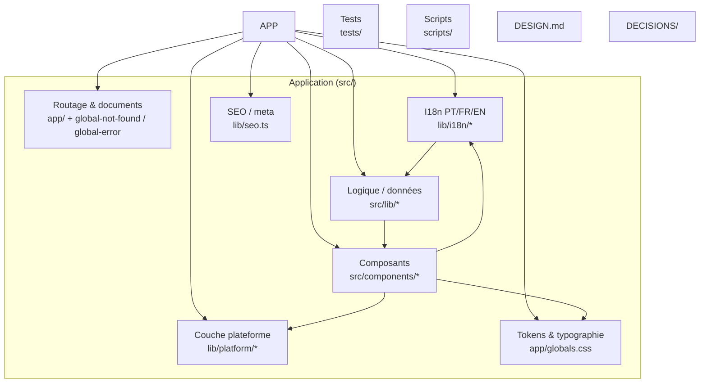

# PROJECT_MAP — Cartographie du dépôt CULTURA

> **Objectif** : permettre à un agent (humain ou IA) d'orienter sa lecture sans charger l'intégralité des sources. Ce document est volontairement **compact** : le code est la source de vérité, la carte n'est qu'un filtre.

- **Méthode** : lire ce fichier → identifier le nœud concerné → ouvrir uniquement les fichiers listés.
- **Source de vérité** : code, ADR (`DECISIONS/`), design (`DESIGN.md`), journal (`PROGRESS.md`).

---

## 1. Arborescence compacte

```text
/
├── AGENTS.md, CLAUDE.md        Règles de travail (source de vérité procédurale)
├── PROGRESS.md                  Journal d'état, verdicts, preuves
├── DESIGN.md                    Design system (v0.2 validé)
├── DECISIONS/                   ADR-001…006
├── BACKLOG.md, QUESTIONS.md    Hors périmètre / arbitrages ouverts
├── i18n/GLOSSAIRE.md            Glossaire PT/FR/EN
├── CULTURA_*.md, CULTURA_MEDIA_GUIDE_v1.0.docx
├── docs/
│   ├── PROJECT_MAP.md           Ce fichier (cartographie)
│   └── captures/                Screenshots de contrôle (fr-360, fr-1120)
├── public/
│   ├── brand/                   logo.svg (+ aperçus png)
│   └── fonts/                   Archivo WOFF2 variables + OFL.txt
├── src/
│   ├── app/
│   │   ├── (default)/           Layout racine documentaire (résolveur `/`)
│   │   ├── (localized)/[locale]/          Routes PT/FR/EN (2 layouts racines)
│   │   │   └── [section]/                  Générique : /pt/semana, /fr/semaine, /en/week
│   │   │       ├── page.tsx              « Hoje » (réglette)
│   │   │       └── layout.tsx            Layout localisé
│   │   ├── global-not-found.tsx          404 document complet
│   │   ├── global-error.tsx             Volet 500 (client)
│   │   ├── icon.png, apple-icon.png     Favicon dérivé de Icone.jpg
│   │   └── globals.css                  Tokens Tailwind 4, .type-*, .ruler-*
│   ├── components/
│   │   ├── site-header.tsx              En-tête, logotype, nav desktop
│   │   ├── mobile-nav.tsx               Barre basse mobile (2 entrées)
│   │   ├── language-switcher.tsx        Sélecteur PT/FR/EN, cookie
│   │   └── time-ruler.tsx               Réglette horaire
│   ├── lib/
│   │   ├── i18n/             locale, cookie, format, messages/, types, index
│   │   ├── platform/          routes, target, index (source des URLs)
│   │   ├── env.ts, env.server.ts, seo.ts, site.ts
│   └── styles/                (tokens vivent dans src/app/globals.css)
├── tests/
│   ├── e2e/                    smoke.e2e.ts (langues, cookie, 404, débordement, design)
│   └── *.test.ts(x)            Vitest (i18n, format, ruler, copy-rules, locale, env, platform…)
├── scripts/                    install-hooks, measure-render
├── .githooks/pre-commit, .gitattributes, .gitleaks.toml
├── playwright.config.ts, vitest.config.mts, next.config.ts, tsconfig.json, tailwind/postcss/eslint/prettier configs
└── package.json, capacitor.config.ts, .env.example
```

## 2. Graphe des responsabilités



Le flux métier actuel : une page locale (`app/(localized)/[locale]/…`) consomme le header, la barre mobile, le sélecteur de langue, la réglette, puis lit les messages via `lib/i18n` ; toute donnée ou mutation passe par `lib/` → `lib/platform` (jamais dans un composant).

## 3. Règles d'usage (rappel AGENTS.md)

1. Une étape à la fois.
2. Jamais seul.
3. Celui qui construit ne valide pas.
4. Pas de preuve, pas de DONE.
5. Aucune idée hors périmètre → `BACKLOG.md`.

## 4. Mode d'emploi pour un agent

1. Lire ce fichier.
2. Repérer le nœud concerné.
3. Ouvrir uniquement les fichiers listés pour ce nœud.
4. Ne pas relire l'intégralité du dépôt pour une question locale.
